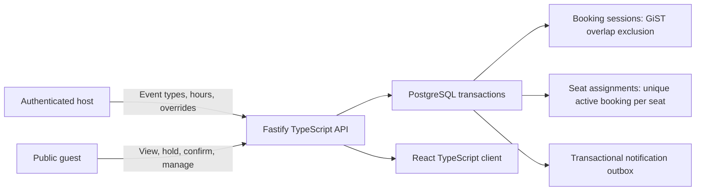
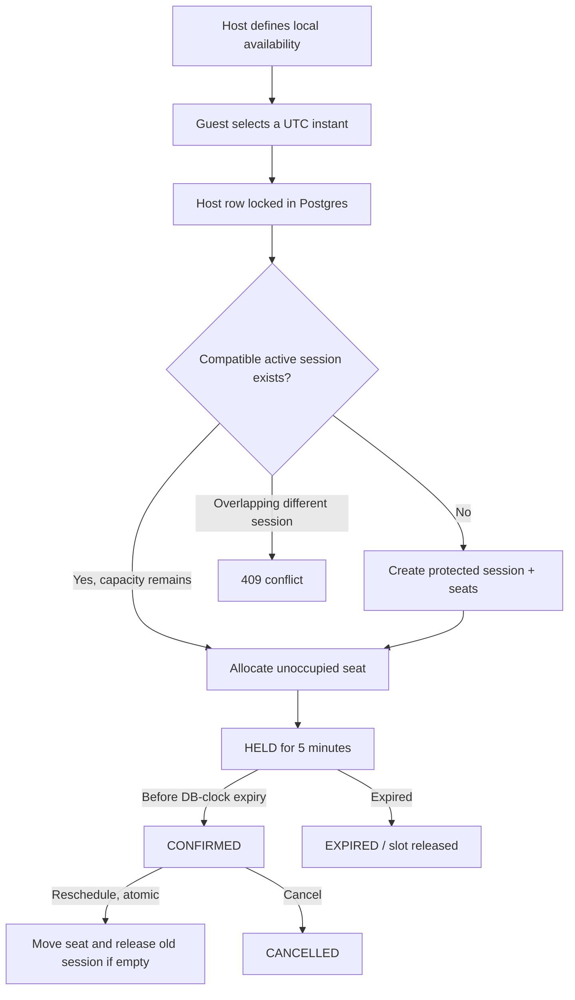
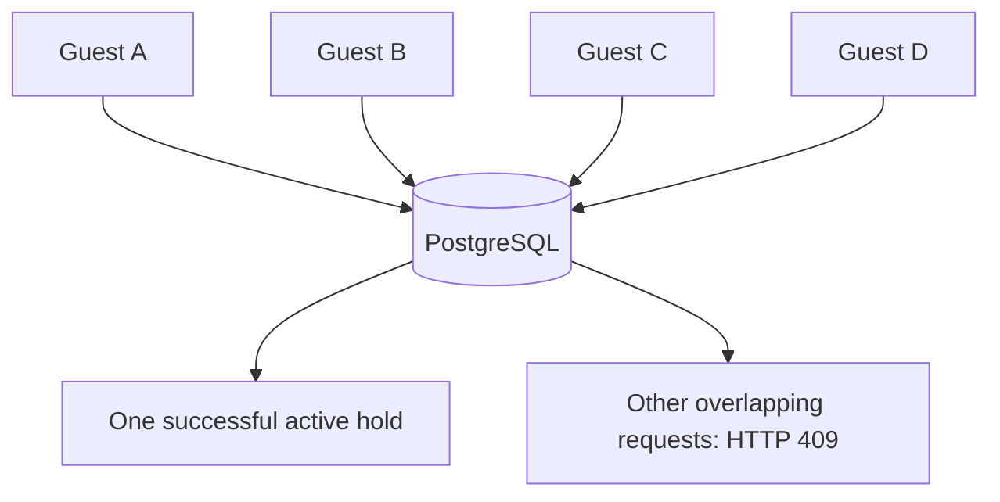

# Slotbook

**A full-stack TypeScript appointment scheduler with PostgreSQL-enforced booking correctness.** Hosts publish schedules; guests book one-to-one appointments or capacity-limited group sessions. Competing requests cannot commit overlapping host sessions or take the same seat twice.

> **Verification:** A prior iteration built and started successfully on the user's Windows PostgreSQL 18 machine, but this revised version includes new changes and requires fresh Windows build/integration/HTTP concurrency acceptance. In this authoring environment, 3 HTTP-contract tests and 4 IANA/DST assertions passed; the full PostgreSQL suite could not run because npm registry packages and a PostgreSQL server were unavailable. The earlier Python 28/28 + 1/49 result belongs to a separate implementation and must never be presented as this TypeScript result. See `docs/VALIDATION_STATUS.md`.

## Release 2 - coordinated booking-product improvements

- **Reliable sign-in/out:** HttpOnly, SameSite cookies; database-backed 12-hour sessions; origin checks on host mutations; explicit logout; IP-scoped demo login throttling. No misleading JSON content type on empty logout requests.
- **Guest experience:** dynamic host directory and event pages, responsive navigation, hold countdown, cancel/change-slot, retry-safe pending hold and confirmation, private manage-link recovery in the same browser tab, clear error/empty states.
- **Host workspace:** working-hour windows, date overrides (save/remove), bookings in host zone, cancellation reason dialog, event edit/deactivation, notification details, metrics, time-zone change acknowledgement.
- **Database safety:** forward-only `002_booking_integrity.sql` adds host/event composite FK and immutable session scheduling/capacity, on top of GiST overlap exclusions, unique active seats, capacity triggers and serialized booking writes.
- **Correct time:** UTC storage, host local generation, guest time-zone display, IANA DST gap/fold rejection, PostgreSQL-clock hold expiry. Slot availability reads do not unnecessarily hold write locks; expired holds are excluded from capacity counts.
- **Abuse/observability:** single-instance IP throttle for login/holds (not a distributed rate limit), redacted structured route logs, authenticated metrics endpoint. Private tokens never appear in logged raw URLs.

Existing confirmed appointments and database data are preserved by migration. Public host signup, password reset, payment delivery and real email sending remain outside the written core brief.

## Run locally on Windows without Docker

Use PostgreSQL 15+ (the existing PostgreSQL 18 installation is supported), Node.js 22+,
**and a separate database from the earlier Python Slotbook**.

1. Create the databases once as a PostgreSQL administrator:
   `CREATE DATABASE slotbook_ts OWNER slotbook;` and
   `CREATE DATABASE slotbook_ts_test OWNER slotbook;`.
2. `Copy-Item .env.example .env`, then edit **only your local** `.env` to use the
   actual `slotbook` role password. The default URLs target `127.0.0.1:5432`,
   databases `slotbook_ts` and `slotbook_ts_test`.
   The `EXPECTED_DATABASE_NAME=slotbook_ts` setting refuses an accidental
   connection to the legacy Python `slotbook` database.
3. `npm install`, `npm run build`, `node --env-file=.env dist/server/src/index.js`.
4. Open `http://localhost:3000/demo-ny/interview` and `/host`.
5. Tests: `npm run test:local` (runs both integration and HTTP-contract suites; needs `slotbook_ts_test`).
   The test runner refuses databases without a `_test` suffix and resets the dedicated test database only.
6. Live 50-request demonstration, with the app running:
   `node --env-file=.env dist/scripts/concurrency.js --attempts 50`.

**Do not publish `.env` or your actual DB password.** If your password includes reserved URL
characters, URL-encode it. Docker Compose supplies its own database URL and is optional.

## 60-second product tour

1. Open **http://localhost:3000** and choose **Browse hosts**. Open the seeded host's **Interview (30m)** or **Group Workshop (60m, capacity 4)**.
2. Pick a date in the host's calendar and select a guest IANA display zone. Use **Hold** (5-minute reservation). Release the hold if you want a different time; a safe retry uses the same idempotency key.
3. Enter a name and email; confirm. Save the private manage link for rescheduling/cancellation.
4. Visit **http://localhost:3000/host** and sign in with the seeded local demo credentials below.
5. Create/edit/deactivate an event, manage weekly hours and date overrides, see host-local upcoming bookings and counters, cancel with a reason and inspect the notification outbox. Test sign out and sign in again.

### Quick start: one command

Install Docker Desktop, then from this repository:

```bash
docker compose up --build
```

- App: **http://localhost:3000**
- Host dashboard: **http://localhost:3000/host**
- Public interview: **http://localhost:3000/demo-ny/interview**
- Group workshop: **http://localhost:3000/demo-ny/workshop**
- Postgres: `localhost:5433` (avoids an existing Windows Postgres on port 5432)
- Demo email: `demo@slotbook.local`
- Demo password: `DemoPass!2026` (local evaluation only; change before public deployment)

Startup runs migrations and idempotent demo seeding automatically. Two event types are seeded. Compose persists PostgreSQL data in a named volume. **Do not use these demo credentials in public production.**

### Run all real PostgreSQL tests

```bash
docker compose --profile test run --build --rm test
```

The integration suite uses the isolated `slotbook_test` database; it deliberately refuses to run without a database name ending in `_test`. This suite resets **only** the test database's host/booking data. It tests one-on-one contention, group capacity, direct SQL exclusion, expiry, retries, reschedule rollback, DST and notification events.

Run the live HTTP contention proof *after* the app is up:

```bash
docker compose exec app npm run test:concurrency -- --attempts 50
```

Expected invariant: one 201, 49 HTTP 409 responses, one active booking persisted. The script fails nonzero if this invariant is not met and writes `docs/evidence/concurrency_result.json` **inside the container**. Export it with `docker cp` if needed. Do not state a measured result until you run the test.

## Product and data flow



### Booking lifecycle



### Four guests want one interview slot



**Winner selection:** first *successfully committed* conflicting transaction wins, **not** necessarily first browser click. All write paths lock the host row, while a native exclusion constraint prevents simultaneous active sessions from overlapping. The winning guest receives a five-minute hold. Others can select another slot.

**Group sessions:** a session has `capacity` numbered seats. Same event, same start time can share its active session, but each seat has one active booking at most. Other session times/event types cannot overlap that host's occupied range, including buffers. Capacity is defended by seat foreign keys, a seat-limit trigger and a partial unique index.

## Database schema at a glance

| Table | Purpose / key invariants |
|---|---|
| `hosts` | Identity, email, salted `scrypt` password hash, IANA home time zone |
| `event_types` | Host, slug, 15–120-minute duration, capacity, 0–30-minute buffers, notice, horizon |
| `weekly_availability` | Multiple non-overlapping windows per weekday |
| `date_overrides` | Day off or custom local-time windows |
| `booking_sessions` | UTC start/end, captured event settings, occupied `TSTZRANGE`; **GiST exclusion per host when active** |
| `session_seats` | Numbered seats, upper-bounded by DB trigger |
| `bookings` | Status, hold expiry, private token hash, seat reference, optimistic version; **unique active seat** |
| `idempotency_records` | Request fingerprint and original response in same transaction as state change |
| `auth_sessions` | Expiring hashed host login token |
| `notification_outbox` | Confirm/reschedule/cancel events committed atomically |

**Critical native constraints** (see [`server/sql/001_initial.sql`](server/sql/001_initial.sql)):

```sql
CONSTRAINT no_host_session_overlap EXCLUDE USING gist (
  host_id WITH =, occupied_range WITH &&
) WHERE (state='active');

CREATE UNIQUE INDEX one_active_booking_per_seat
  ON bookings(session_id,seat_no)
  WHERE status IN ('held','confirmed');
```

Times use `[start, end)` boundaries; adjacent bookings are allowed unless buffers overlap. Active `held` and `confirmed` bookings count against session capacity. `expired` and `cancelled` do not.

## Network, clock and transaction reliability

- **Hold:** host row lock -> expire stale holds by `clock_timestamp()` -> validate host-local schedule and current capacity -> allocate seat/insert hold -> commit idempotency record and response.
- **Confirm:** secret token required; host lock; expiry checked using the DB clock; update and notification event in the same transaction.
- **Reschedule:** private manage token and `expected_version` required. Release the old session if this was its last member, acquire new session/seat, update the *same* booking, emit notification. On constraint/availability failure the transaction rolls back, retaining the original appointment.
- **Cancel:** host dashboard requires a reason; private guest manage link can cancel. Release session when empty and emit event.
- **Network response lost:** retry same `Idempotency-Key` and same payload to retrieve the committed response. Reusing the key with a different request yields HTTP 409.
- **Expired hold:** 60-second worker cleans abandoned holds; every booking write path also expires stale holds while holding a host-row lock. If worker stops, correctness remains; cleanup can be delayed until next booking request.
- **Timezone:** slots originate in the host's IANA zone; conversion to UTC is strict for DST folds/gaps; guest sees the same instant rendered in their zone. For example, New York Dec 1 09:00 = 14:00 UTC = Bengaluru 19:30.

## Documented API

| Method | Path | Purpose |
|---|---|---|
| GET | `/api/hosts/:host/events/:event/slots?from=YYYY-MM-DD&to=YYYY-MM-DD&tz=Asia/Kolkata` | Available slots and seats |
| POST | `/api/holds` | `{event_id,start_at}`; `Idempotency-Key` |
| POST | `/api/holds/:id/confirm` | `{guest_name,guest_email}`; `X-Booking-Token`, `Idempotency-Key` |
| GET | `/api/bookings/:token` | Private manage-booking view |
| POST | `/api/bookings/:token/reschedule` | `{start_at,expected_version}`; `Idempotency-Key` |
| POST | `/api/bookings/:token/cancel` | `{reason}`; `Idempotency-Key` |
| POST | `/api/auth/login` | Host sign-in (HTTP-only cookie) |
| GET/POST | `/api/host/events` | Read / create host event types |
| GET/PUT | `/api/host/schedule` | Weekly hours (multiple windows) |
| PUT | `/api/host/overrides/:day` | Date closure/custom windows |
| GET | `/api/host/bookings` | Upcoming host bookings |
| POST | `/api/host/bookings/:id/cancel` | Host cancellation with reason |
| GET | `/api/notifications` | Authenticated notification sink |
| GET | `/api/health`, `/api/health/ready` | Health and DB readiness |

**API example:**

```bash
curl -X POST http://localhost:3000/api/holds \
  -H 'Content-Type: application/json' -H 'Idempotency-Key: request-12345678' \
  -d '{"event_id":"EVENT_UUID_FROM_SLOTS_API","start_at":"2026-12-01T14:00:00.000Z"}'
```

## Development without Docker

Requires Node 22+, npm, PostgreSQL 15+, two databases `slotbook` and `slotbook_test`, and a Postgres user with create-extension permission for `btree_gist` and `pgcrypto`. Copy `.env.example` to `.env` and update the URLs. On Node 22, environment files can be read via `node --env-file=.env`. Then:

```bash
npm install
npm run build
node --env-file=.env dist/server/src/index.js
```

For React live development, run `npm run dev:web` in a second terminal; Vite serves `http://localhost:5173` and proxies `/api` to port 3000.

To execute tests manually, set `DATABASE_URL` and `TEST_DATABASE_URL` to the **test** DB before `npm test`; do not set them to your production or development booking database. Do not run the test suite on the existing Python Slotbook database.

## Repository map

```text
server/sql/001_initial.sql   Database schema and native invariants
server/src/time.ts          Strict IANA timezone/DST conversion
server/src/slots.ts         Host-local availability generation
server/src/service.ts       Transactions, capacity, idempotency, expiry
server/src/auth.ts          Host auth and private guest tokens
server/src/app.ts           Fastify JSON API + React static serving
web/src/                   React host dashboard and guest pages
tests/integration.test.ts   Real PostgreSQL end-to-end and concurrency tests
scripts/concurrency.ts      HTTP contention test and DB row verification
AI_LOG.md                   AI usage, review, corrections and gaps
docs/                      Report, design and validation notes
```

## Optional extensions and known gaps

**Additional optional capabilities:** single-process login/hold abuse throttling, host metrics, redacted route logging and CI automation. Group sessions, the transactional notification sink, the expiry worker, seeded host login and cancellation reason are part of the written core or its implementation; concurrency testing is essential evidence, not an optional feature.

**Not implemented:** external email/reminder delivery, calendar sync/ICS, payments, team round-robin, waitlists, public deployment, advanced anti-bot protection or Playwright browser automation. Notifications are persisted, not sent. No throughput/p95 benchmark is claimed.

**Validation:** The coordinated release passed 3 standalone HTTP-contract tests, 4 IANA/DST checks and syntax parsing of all TS/TSX source files; the authoring environment could not install npm packages or start PostgreSQL. The user's earlier Windows build and startup applied to the previous source revision. This release's full build and database tests are **not yet verified**. Run the commands above, fix any failing checks and attach their real output before claiming a pass. See [`docs/VALIDATION_STATUS.md`](docs/VALIDATION_STATUS.md).

**AI and provenance:** See [`AI_LOG.md`](AI_LOG.md). Do not squash Git history after publishing. A future public URL is to be added to the report before submission.
